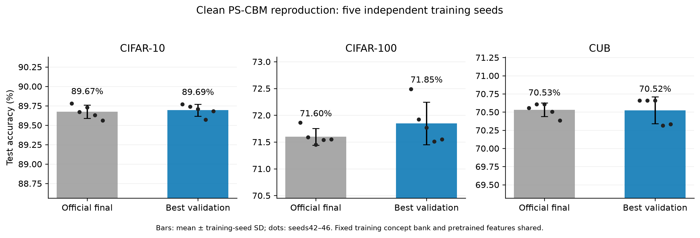
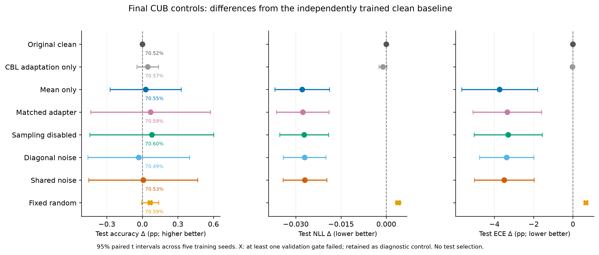
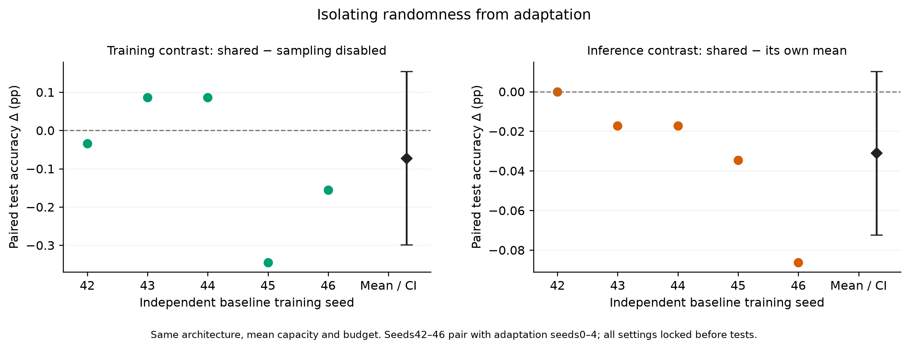
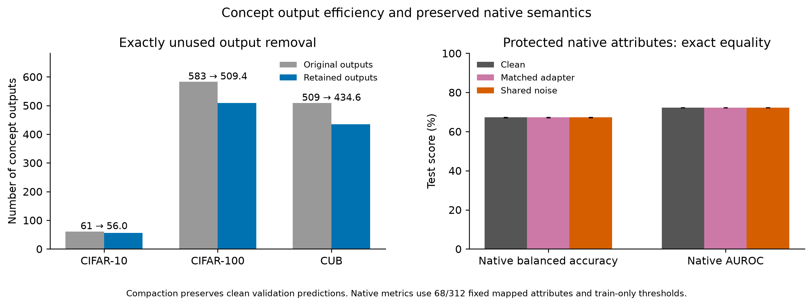

# PS-Shared-Pi 最终实验结果

**交付日期：2026-10-09。** 已停止新增参数搜索与细小消融；冻结 V22-B 设置，完成 CUB 七组控制×五个独立训练种子，以及三个数据集的五种子干净基线测试。

**主要结论：** CUB 测试准确率：原始干净模型 **70.52 ± 0.18%**，参数匹配适配器 **70.59 ± 0.31%**，共享噪声 **70.53 ± 0.34%**。未获得共享随机分量可靠优于强确定性对照的证据；不能把适配收益归因于噪声。

**最终实现：** `ps_pi/final_infer.py`。默认使用测试前选定的参数匹配确定性适配器；`--mode shared_noise` 加载冻结的共享噪声版本。共享部分采用训练弱视图估计的有符号因子，协方差为 `diag(σ²) + B diag(γ²) Bᵀ`；均值容量与强确定性控制一致，推理无需真实类别。68 项映射属性涉及的161个概念通道由固定参考CBL输出提供，其余概念允许自适应CBL学习。

| 固定协议 | 设置 |
|---|---|
| 原始方法 | Partially Shared CBM，AAAI 2026；官方提交 `749c6e3`，78个文件哈希核验 |
| 独立重复 | 基线种子42–46，分别配对适配种子0–4；共享训练概念库与预训练图像特征 |
| 最终训练 | CUB，40轮；CBL LR 3e-6；生成器 LR 1e-3；概念权重5；批量128；mixup α=0.2 |
| 采样 | 训练4次，验证选epoch32次；冻结后评估 MC256×两个固定种子，平均类别概率 |
| 选模 | 仅验证集：ACC/NLL/ECE/伪概念BCE和原生BA/AUROC不退化，概念漂移≤0.3，再按正确数/NLL选epoch |
| 原生属性 | 训练标注决定映射、保护集合和阈值；没有原生属性训练损失；所有控制使用相同辅助约束 |
| 测试 | 所有参数、方法和检查点锁定后评估；不依测试结果调参或重新挑模型 |

## 1. 完整干净基线复现

**目的：** 确认官方预算可复现，单独衡量最佳验证权重保存修正，避免将此收益算作Pi噪声收益。



| 数据集 | 最佳验证状态：验证ACC (%) | 官方末轮：测试ACC (%) | 最佳验证状态：测试ACC (%) |
|---|---:|---:|---:|
| CIFAR-10 | 90.73 ± 0.11 | 89.67 ± 0.09 | 89.69 ± 0.08 |
| CIFAR-100 | 72.33 ± 0.15 | 71.60 ± 0.16 | 71.85 ± 0.40 |
| CUB | 68.55 ± 0.28 | 70.53 ± 0.09 | 70.52 ± 0.18 |

**结论：** 三个数据集均完成五次独立CBL/SAGA训练。末轮与最佳验证状态使用同预算重新拟合官方稀疏头；两者差异属于检查点策略。CIFAR表仅代表干净基线复现，未宣称该最终Pi在CIFAR完成五种子实验。

## 2. CUB 最终主要对照

**目的：** 在相同双分支CBL、生成器容量、训练数据和预算下，区分概念适配、确定性均值与随机采样的贡献。



| 方法 | 验证ACC (%) | 测试ACC (%) | 测试NLL ↓ | 测试ECE (%) ↓ | 验证门槛通过 |
|---|---:|---:|---:|---:|---:|
| 原始干净基线 | 68.55 ± 0.28 | 70.52 ± 0.18 | 1.1015 ± 0.0025 | 10.84 ± 0.19 | 5/5 |
| 仅CBL适配 | 68.63 ± 0.29 | 70.57 ± 0.17 | 1.1004 ± 0.0033 | 10.82 ± 0.16 | 5/5 |
| 仅均值（弱控制） | 69.51 ± 0.35 | 70.55 ± 0.15 | 1.0736 ± 0.0070 | 7.11 ± 1.39 | 5/5 |
| 参数匹配适配器 | 69.58 ± 0.39 | 70.59 ± 0.31 | 1.0738 ± 0.0075 | 7.50 ± 1.28 | 5/5 |
| 共享模型关闭训练采样 | 69.57 ± 0.37 | 70.60 ± 0.31 | 1.0743 ± 0.0068 | 7.54 ± 1.27 | 5/5 |
| 对角噪声 | 69.56 ± 0.39 | 70.49 ± 0.33 | 1.0745 ± 0.0051 | 7.47 ± 1.04 | 5/5 |
| 共享噪声 | 69.52 ± 0.39 | 70.53 ± 0.34 | 1.0745 ± 0.0052 | 7.35 ± 1.17 | 5/5 |
| 固定随机噪声 | 68.76 ± 0.30 | 70.59 ± 0.18 | 1.1054 ± 0.0029 | 11.50 ± 0.19 | 0/5 |

**结论：** 未获得共享随机分量可靠优于强确定性对照的证据；不能把适配收益归因于噪声。 确定性适配将测试NLL从1.1015降至1.0738、ECE从10.84%降至7.50%；主要可见改善是预测概率质量。表中保留未通过验证门槛的控制，不能将其高测试分数事后提升为合格候选。数值为五种子均值±样本标准差，图中的差值误差线为五种子配对t区间。

## 3. 随机性是否带来额外收益

**目的：** 主比较关闭训练采样的同结构模型；另用同一共享模型关闭推理尺度，检查推理期随机平均本身的收益。



| 测试配对比较 | ACC差值 (pp) | 五训练种子95%配对区间 | 同测试图像bootstrap区间 |
|---|---:|---:|---:|
| 共享噪声 − 原始干净模型 | +0.01 | [-0.45, +0.47] | [-0.40, +0.43] |
| 共享噪声 − 关闭训练采样（主比较） | -0.07 | [-0.30, +0.15] | [-0.29, +0.15] |
| 共享噪声 − 参数匹配适配器 | -0.06 | [-0.26, +0.13] | [-0.30, +0.17] |
| 共享噪声 − 同模型均值推理 | -0.03 | [-0.07, +0.01] | — |

**结论：** 主比较差值为 -0.07 pp，五种子95%区间 [-0.30, +0.15]；对参数匹配适配器为 -0.06 pp，区间 [-0.26, +0.13]。未获得共享随机分量可靠优于强确定性对照的证据；不能把适配收益归因于噪声。

**区间口径：** 配对t区间仅反映五个训练种子的差值，样本小；图像bootstrap使用2000次共同图像重采样，条件于这五个已训练模型，两种区间没有合并。MC种子只增加积分精度，不充当独立模型种子。

## 4. 属性保护与概念输出精简

**目的：** 检查分类适配是否改变固定映射的真实属性响应，并删除稀疏分类头完全不用的概念输出。



| 模型 | CUB测试原生BA (%) | CUB测试原生AUROC (%) | 受保护响应 |
|---|---:|---:|---|
| 原始干净基线 | 67.29 ± 0.08 | 72.22 ± 0.04 | 参考 |
| 参数匹配适配器 | 67.29 ± 0.08 | 72.22 ± 0.04 | 逐元素完全一致 |
| 共享噪声 | 67.29 ± 0.08 | 72.22 ± 0.04 | 逐元素完全一致 |

**结论：** 五个最终基线对应的68项映射属性BA/AUROC保持一致，逐元素恒等参照为同结构的干净精简CBL；完整/精简GPU计算的浮点舍入差异及完整模型属性指标另存JSON。保护仅覆盖68/312项，未测定位质量。15个干净模型的精简验证预测保持不变：CIFAR-10保留55–57/61，CIFAR-100保留505–513/583，CUB保留433–437/509个输出。固定参考分支与生成器增加整体参数，不能把输出精简称为Pi整网减参或速度收益。

## 复现与交付

```bash
cd PS-Shared-Pi
python -m ps_pi.final_run                     # 冻结的35个CUB控制，可检查完成状态后跳过
python -m ps_pi.final_workflow                # 锁定检查点，验证与测试评估
python -m ps_pi.final_report                  # 从真实预测结果重建本报告与四张图
python -m ps_pi.final_infer --features /path/RN50_features.pt --output /path/predictions.pt
# 共享噪声版本：追加 --mode shared_noise
```

[最终结果逐项核验](reports/final_v1/VERIFICATION.json)：65个锁定检查点，130组最终预测数组和70组受保护属性概率复算。

模型、图像特征和逐样本预测保留在本地 `outputs/`、`artifacts/`，不上传数据集；完整结果表、协议、图表PNG/SVG/PDF已归档。运行推理需使用与训练一致的冻结RN50特征；无需真实类别。

[冻结设置](reports/final_v1/LOCK.json) · [交付模型的测试前选择](reports/final_v1/DELIVERY_PLAN.json) · [检查点/评估源码锁](reports/final_v1/EVALUATION_LOCK.json) · [全部最终结果JSON](reports/final_v1/results.json) · [结果CSV](reports/final_v1/metrics.csv) · [历史验证探索](reports/validation_v1/主要实验进展.md)

**范围：** 最终共享噪声五种子结论限于CUB；CIFAR为干净基线测试。数据集在本项目其他基线阶段已有测试评估，此处是PS阶段协议锁定后的评估。验证探索结果不视为独立测试证据，也没有在看到测试后更换交付默认模型。
