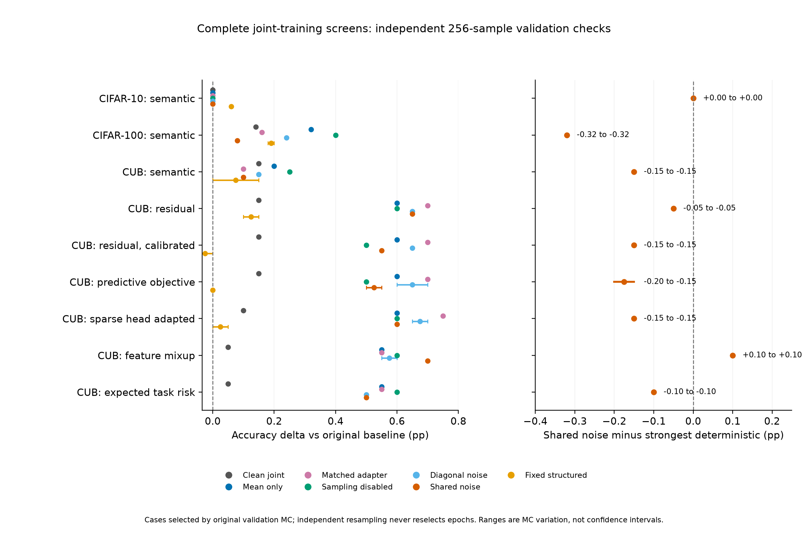
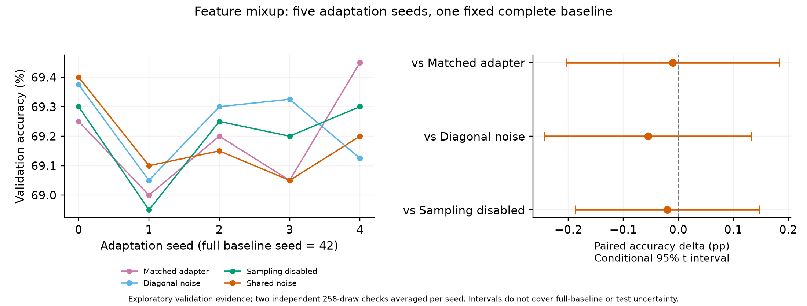

# PS-CBM 主要实验进展

已完成三个 RN50 基线、202 条注册验证运行（不含调试运行）。**最强 CUB 确定性适配达到 69.45%，尚未证明随机分量的额外收益。** 主队列为基线种子 42、适配种子 0；另有固定基线下五个适配种子的条件复验，仍不是五个独立完整基线。重复控制不算独立种子。测试集保持隔离，最终五种子验证尚未完成。

[完整基线图](02_complete_baselines.png)

**目的：** 按官方文件名划分和配置建立基线，区分官方末轮权重与正确保存的最佳验证权重。

**结论：** 最佳验证权重的 CIFAR-10 / CIFAR-100 / CUB 准确率为 **90.72% / 72.36% / 68.70%**，概念数为 **61 / 583 / 509**。不能与论文测试成绩直接比较。详见 [基线表](首轮基线.md)。

**共同目的：** 保留干净联合微调、仅均值、同容量非线性适配、相同生成器关闭采样、对角噪声和固定随机噪声，以相同预算区分适配与随机性作用。每组两套预登记配置、八类方法；先按原验证 MC 选权重，再以两个独立种子各 256 次采样复核。高采样复核不重新选权重或配置。

| 完整队列 | 最强确定性对照 | 共享噪声（原选择固定后复核） |
|---|---:|---:|
| CIFAR-10: semantic | 90.72% | 90.72% |
| CIFAR-100: semantic | 72.76% | 72.44% |
| CUB: semantic | 68.95% | 68.80% |
| CUB: residual | 69.40% | 69.35% |
| CUB: residual, calibrated | 69.40% | 69.25% |
| CUB: predictive objective | 69.40% | 69.20–69.25% |
| CUB: sparse head adapted | 69.45% | 69.30% |
| CUB: feature mixup | 69.30% | 69.40% |
| CUB: expected task risk | 69.30% | 69.20% |

| 实验 | 目的 | 结论 |
|---|---|---|
| 前四轮（42 条） | 检验冻结模型的噪声适配、概念 mixup、边际似然和交叉拟合 | 没有满足性能与质量门槛的独立随机收益。 |
| 语义方向联合训练（48 条） | 在 CBL 学习期间注入训练概念方向噪声 | CIFAR-10 共享模型选第 0 轮，90.74% 复核回到 90.72%；CIFAR-100 共享模型未超过 72.76% 的关闭采样对照。原概念门槛不合格的高分模型不晋级。 |
| 类内残差方向（16 条） | 从训练类内变化中去除概念均值方向，降低属性扰动 | CUB 相同输入噪声能量下训练子集概念漂移由 0.105 降到 0.022；确定性适配达到 69.40%，噪声未超过它。 |
| 训练敏感度校准（16 条） | 用训练漂移比值确定尺度 0.481，避免验证尺度搜索 | 加大残差噪声后仍没有额外分类收益。 |
| 联合预测似然（16 条） | 用实际平均预测概率的分类/概念似然，保持概念均值而非惩罚每次采样 | 独立复核共享模型为 69.20%–69.25%，未超过同轮 69.40% 的适配对照。 |
| 原稀疏分类头适配（16 条） | 让已有稀疏头适应新的概念分布，所有对照更新相同非零支持 | 663 个原非零位置保持不变；确定性适配达到 69.45%，共享模型复核为 69.30%。 |
| 特征层 mixup（16 条） | 改善 CBL 训练覆盖，固定 alpha=0.2，使用软目标边际似然 | 共享模型复核 69.40%，比同配置关闭采样高 0.10 pp；同配置 A 对角噪声 69.35%–69.40%，共享结构没有额外优势。 |
| 期望分类风险（16 条） | 只将分类目标改为逐次采样交叉熵，保留概念边际似然、均值保持和 mixup | 共享模型为 69.10% / 69.20%，未超过关闭采样的 69.30%。 |

**目的：** 固定基线种子 42、原配置 A 和 mixup alpha=0.2，新增适配种子 1–4，与种子 0 合成五个条件种子的同容量、对角、关闭采样和共享对照。全部种子保留，独立 MC 不重选模型。

**结论：** 共享噪声相对关闭采样的平均差值 **-0.02 pp**，条件配对 95% t 区间 **[-0.19, +0.15] pp**，跨过零；相对同容量适配/对角噪声也没有可靠优势。首个种子的 +0.10 pp 没有稳定重复。共享属性 BA 平均改变 **-0.24 pp**，仍非解释提升。该区间仅覆盖适配种子变化，不覆盖完整基线、概念库或测试不确定性。

**解释检查：** CUB 原始人工属性按明确颜色/部位保守映射，覆盖 **68/312 属性**；筛选及阈值仅用训练集，验证排除 certainty < 3。基线 BA / AUROC 为 **67.43% / 72.52%**。共享方案 BA 仍略降，不能宣称解释提升；覆盖有限，且没有定位或因果干预证据。

**效率与限制：** 概念数不变，CEA 随准确率同比变化；CEA 是论文紧凑度代理，不能替代人工属性质量。对照总览（04）横线是 Monte Carlo 范围，**不是置信区间**；条件复验（05）横线是注明范围的适配种子配对 t 区间。解析高斯概念均值用于区分非线性均值变化与随机推理效果，不替代重新训练的确定性对照。

**继续迭代：** 特征 mixup 的条件复验未确认可靠优势。期望分类风险也未确认优势。现只用训练图像的反射填充轻微平移与翻转，准备实测特征变化，下一步检验不同噪声方向。尚未完成的案例不纳入图表。Goal 保持 active；仍需可靠候选、独立五种子、配对区间及最终测试。

主要数值、CEA、属性变化和来源哈希见 [CSV](major_results.csv)、[来源汇总](major_results.json)。早期详细对照保留在 [首轮 CSV](validation_v1.csv)、[联合训练复核](joint_v5_summary.json)。
