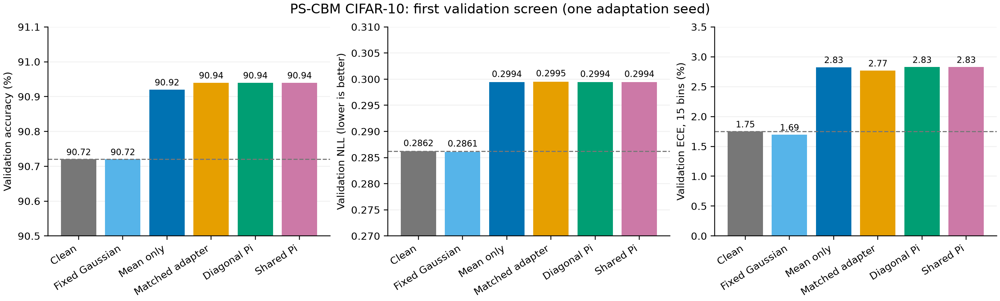
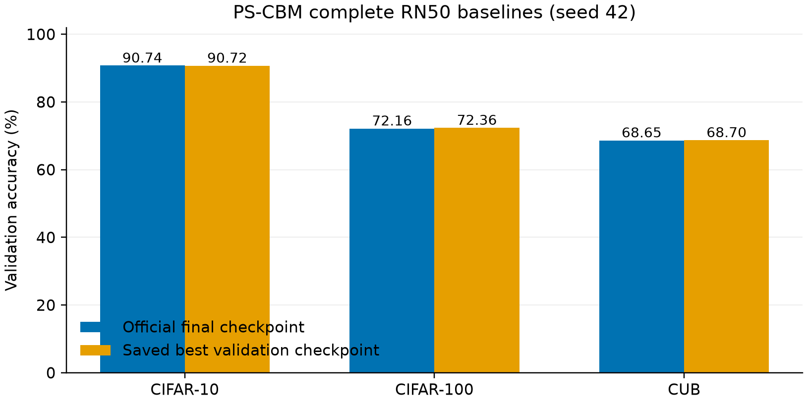

# PS-CBM 主要实验进展

当前只报告完整验证集。未打开测试特征；这是单种子的探索阶段，尚未锁定方案或完成五种子独立验证。

**目的：** 检查可学习噪声是否优于干净、仅均值、同容量确定性适配与固定随机噪声，同时观察校准。

**结论：** 在同一首轮配置（概念损失 0.1、能量损失 0.01、40 epoch）下，共享 Pi 验证准确率为 90.94%，干净基线为 90.72%，同容量适配为 90.94%。共享 Pi 关闭随机尺度后准确率为 90.94%，随机分量额外增益为 0.00 个百分点。因此不能把这次提升归因于随机噪声。共享 Pi 的 NLL 和 ECE 也高于干净基线，当前配置不满足下一阶段校准要求。

共享 Pi 的随机能量比例为 0.24%；14/61 个概念允许共享因子相关噪声。所有学习方法分配相同的 24,964 个参数，同容量适配激活确定性分支，固定随机对照没有可训练参数。详细九组探索结果见 [CSV](validation_v1.csv)。同一个基线种子 42、适配种子 0、相同批次顺序；验证 Monte Carlo 使用固定种子和 64 个反向配对样本。图中纵轴范围明确标出，单种子不绘制虚假的种子区间。

**首轮之后：** 已完成 mixup、预测概念边际似然和交叉拟合的对照；三个完整基线也已完成。后续结果见下方汇总，训练和选择仍只使用训练/验证数据。

首轮官方末轮与正确保存最佳验证权重的独立结果见 [首轮基线](首轮基线.md)。伪标签概念 BCE 是自动监督的诊断指标，不能代替 CUB 人工属性或因果解释验证。

## 完整基线与后续对照

**目的：** 确认三个优先数据集都已建立官方配置的完整可比基线，避免将权重保存修正或不同划分的差异计为 Pi 收益。

**结论：** 最佳验证权重对应 CIFAR-10 90.72%、CIFAR-100 72.36%、CUB 68.70%；详情见 [基线表](首轮基线.md)。这些是各自完整验证集的单种子成绩。

首轮九组、第二轮八组、第三轮 GPU 八组与独立 CPU 八组、CUB 三折 CBL 交叉拟合后的九组，共完成 **42 组验证对照**。第二/第三轮没有获得同时优于干净基线并满足预先记录的校准与概念门槛的学习方案。第三轮保留初始均值为零的随机模型，NLL 略低，但准确率没有提升。CUB 交叉拟合后，对角噪声的一组模型虽降低 ECE，却使准确率降到 66.95%，因此不符合性能目标；共享噪声也未获可靠提升。

**下一步：** 冻结 CBL 后再拟合扰动的路线目前没有足够证据。将检验训练期间的结构化特征噪声，并保留相同训练预算的干净、均值、确定性适配、固定随机对照，继续隔离测试集。五种子与人工属性验证仍未完成，不能将当前探索结果视为最终结论。完整状态与逐组来源哈希见 [迭代汇总](iteration_summary.json)。
