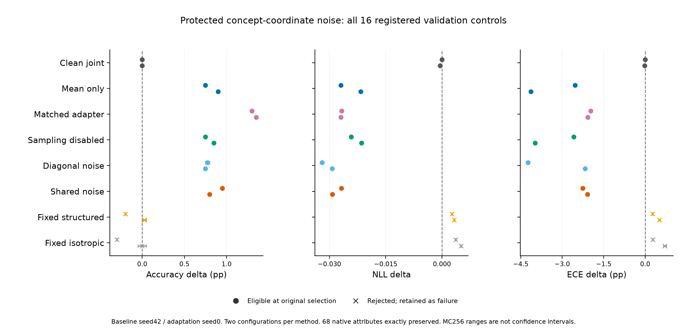

# 属性通道保护的共享结构噪声

**目的：** 在433个精简概念输出中保护161个映射属性通道，只在其余272通道适配/加噪，检查强确定性对照下随机训练的额外收益。全部方法使用同一精简CBL、冻结头、数据顺序和预算；本轮没有原生属性训练损失，但使用训练属性标注确定保护映射/集合和阈值；这是同条件的辅助解释约束，不能当作纯原始PS-CBM监督设置。

**协议：** 两配置×八方法、40轮、四次概念采样；CBL每图仅计算一次。噪声条件是当前干净概念的停止梯度值；条件协方差为diag(σ²)+B diag(γ²) Bᵀ，B由原概念共享类别关系确定，推理不用真实类别。均值上限0.3，与尺度上限相同。固定CBL隐藏层及161个属性输出行，屏蔽对应均值和协方差，Adam更新后恢复受保护行；保留标准化及分类头支持。残差重构及受保护通道的解析概率保证零扰动恒等。

**选模：** ACC/NLL/ECE/伪概念BCE不退化、漂移≤0.3、原生BA/AUROC不退化，再按原验证正确数/NLL选epoch及配置。固定选择后用MC256×两种子复核，不重新选模。

| 方法 | 原选择合格配置 | 独立MC验证ACC（%） | 原生BA变化（pp） | 原生AUROC变化（pp） |
|---|---|---:|---:|---:|
| Clean joint | clean_seed0_cw5_lr3e-06 | 68.70 | +0.000 | +0.000 |
| Mean only | mean_only_seed0_cw5_lr3e-06 | 69.60 | +0.000 | +0.000 |
| Matched adapter | adapter_matched_seed0_cw5_lr3e-06 | 70.05 | +0.000 | +0.000 |
| Sampling disabled | shared_no_sampling_seed0_cw5_lr3e-06 | 69.55 | +0.000 | +0.000 |
| Diagonal noise | diag_noise_seed0_cw1_lr1e-05 | 69.45–69.50 | +0.000 | +0.000 |
| Shared noise | shared_noise_seed0_cw1_lr1e-05 | 69.65 | +0.000 | +0.000 |
| Fixed structured | 无合格配置 | — | — | — |
| Fixed isotropic | 无合格配置 | — | — | — |

**结论：** 共享噪声相对本轮最强合格确定性对照的独立MC差值为-0.40–-0.40 pp。这是单基线、单适配种子的探索；即使为正，也需要预先锁定后独立五种子复验。

**属性保护核验：** 每个检查点以MC256重算受保护概念概率，并与原始基线逐元素比对；审计要求概率响应完全相同、68项属性的BA/AUROC完全相同，否则停止。该恒等只覆盖固定映射的68/312项，不能推断其余属性或定位质量。

**参数口径：** 全部控制分配同一193,066参数生成器。原精简CBL+稠密头为1,350,571参数，连生成器为1,543,637参数，高于原509输出干净CBL+头的1,404,531；减少概念输出不等于Pi整网参数更少，也没有时延/显存测量。冻结图像编码器不计入这些数值。

**范围与限制：** 精简本身是各对照共同的干净模型效率改进，不是随机噪声收益。伪概念BCE在保留的433输出上计算，与509输出旧队列绝对值不能直接比较。直接概念采样使其期望等于同检查点均值推理，但均值logits与平均类别概率仍不同。结构零相关仅指给定图像的条件协方差。真实属性覆盖68/312项，仍没有定位证据。

[全部配置及失败门槛](protected_study.csv)、[来源哈希](protected_study.json)、[精简基线核验](概念输出精简.md)。
