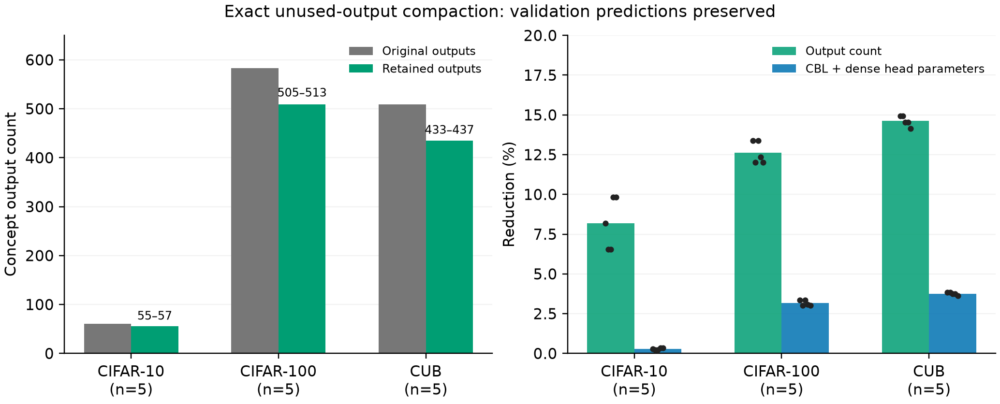

# 概念输出精简：干净基线效率证据

**目的：** 删除分类头完全不使用的概念输出，同时保留原生属性审计依赖的概念。保留规则只读取训练所得权重和训练确定的属性映射，不按验证表现挑选概念。

| 数据集 | 已完成基线种子数 | 原输出数 | 保留输出数范围 | CBL+稠密头参数减少范围 | 验证预测改变数 |
|---|---:|---:|---:|---:|---:|
| CIFAR-10 | 5 | 61 | 55–57 | 0.22%–0.33% | 0 |
| CIFAR-100 | 5 | 583 | 505–513 | 3.00%–3.35% | 0 |
| CUB | 5 | 509 | 433–437 | 3.64%–3.84% | 0 |

**结论：** 已核验基线的验证分类预测保持不变，NLL/ECE仅有浮点误差范围内差异。CUB五种子保留全部161个属性映射涉及的概念，68项已映射属性的BA/AUROC不变。compact检查点已保存并重新加载验证。

**实现口径：** 只裁掉最后一个概念线性层的输出行、对应标准化参数和分类头输入列，原隐层宽度保持不变。必须保留任意非零头权重，即使其幅值小于NEC计数阈值；以阈值近零代替精确零不能保证恒等。

**限制：** 这是干净模型的输出精简，不是Pi噪声收益。参数减少仅计算CBL和稠密存储的分类头，未包括冻结图像编码器，没有时延或显存测量。CUB属性保护仅覆盖固定映射的68/312项。尚未裁剪共享隐层或已训练生成器的概念条件输入。输出数下降不等于整网同等比例加速，也不作为与原论文构建概念数直接匹配的SOTA比较。

[逐基线核验数据](compact_baselines.json)、[CSV](compact_baselines.csv)、[独立基线属性阈值准备](baseline_contexts.json)。
