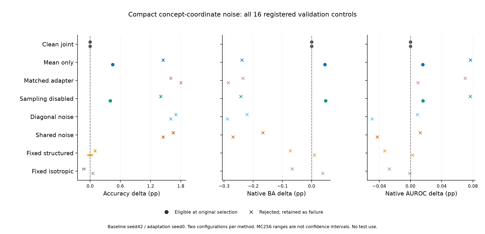

# 精简概念层的共享结构噪声

**目的：** 在433个精简概念输出上直接施加条件共享协方差，检查强确定性对照下随机训练的额外收益。全部方法使用同一精简CBL、冻结头、数据顺序和预算；本轮没有原生属性训练损失，但使用训练属性标注确定保护映射/集合和阈值；这是同条件的辅助解释约束，不能当作纯原始PS-CBM监督设置。

**协议：** 两配置×八方法、40轮、四次概念采样；CBL每图仅计算一次。噪声条件是当前干净概念的停止梯度值；条件协方差为diag(σ²)+B diag(γ²) Bᵀ，B由原概念共享类别关系确定，推理不用真实类别。均值上限0.3，与尺度上限相同。保留真实属性通道、原隐层宽度、标准化及分类头支持。

**选模：** ACC/NLL/ECE/伪概念BCE不退化、漂移≤0.3、原生BA/AUROC不退化，再按原验证正确数/NLL选epoch及配置。固定选择后用MC256×两种子复核，不重新选模。

| 方法 | 原选择合格配置 | 独立MC验证ACC（%） | 原生BA变化（pp） | 原生AUROC变化（pp） |
|---|---|---:|---:|---:|
| Clean joint | clean_seed0_cw1_lr1e-05 | 68.70 | +0.000 | +0.000 |
| Mean only | mean_only_seed0_cw5_lr3e-06 | 69.15 | +0.046 | +0.016 |
| Matched adapter | 无合格配置 | — | — | — |
| Sampling disabled | shared_no_sampling_seed0_cw5_lr3e-06 | 69.10 | +0.048 | +0.016 |
| Diagonal noise | 无合格配置 | — | — | — |
| Shared noise | 无合格配置 | — | — | — |
| Fixed structured | 无合格配置 | — | — | — |
| Fixed isotropic | 无合格配置 | — | — | — |

**结论：** 共享噪声没有通过全部预登记门槛的配置，不能将失败模型的高分当成成功。

**数值诊断：** 零均值的标准化→原始响应重构让部分确定性初始状态的AUROC偏移约1.08×10⁻⁸，严格门槛因此拒绝这些初始状态。已登记选择保持原样，未重选；它限制了本轮初始化对照解释。共享高分模型另有真实属性BA下降，不据数值问题晋级。下一独立协议使用残差重构修正。见[诊断](compact_v17_numeric_diagnostic.json)。

**参数口径：** 全部控制分配同一193,066参数生成器。原精简CBL+稠密头为1,350,571参数，连生成器为1,543,637参数，高于原509输出干净CBL+头的1,404,531；减少概念输出不等于Pi整网参数更少，也没有时延/显存测量。冻结图像编码器不计入这些数值。

**范围与限制：** 精简本身是各对照共同的干净模型效率改进，不是随机噪声收益。伪概念BCE在保留的433输出上计算，与509输出旧队列绝对值不能直接比较。直接概念采样使其期望等于同检查点均值推理，但均值logits与平均类别概率仍不同。结构零相关仅指给定图像的条件协方差。真实属性覆盖68/312项，仍没有定位证据。

[全部配置及失败门槛](compact_study.csv)、[来源哈希](compact_study.json)、[精简基线核验](概念输出精简.md)。
